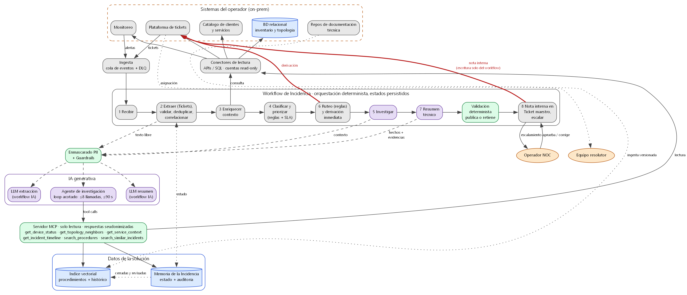

# Reto técnico AI Engineer · Gestión de Incidencias de Red

Diseño de una solución que reduce el tiempo de análisis de incidencias de red para operadores de telecomunicaciones, con IA generativa acotada y sin capacidad de actuar sobre la red.

**Tesis:** un workflow determinista orquesta las 8 actividades, un único agente investiga causas probables con tools de solo lectura, y dos llamadas LLM puntuales extraen campos y redactan el resumen. Todo lo que tiene una regla conocida (urgencia, prioridad, SLA, ruteo, escalamiento, escritura) queda fuera del LLM. Corre en AWS en topología híbrida, con una cuenta por operador.

**Flujo en una línea:** recibir → extraer y validar → enriquecer → priorizar → **derivar por regla (en segundos)** → investigar → resumir → validar → nota interna en el ticket. La derivación no espera a la IA; solo espera a un humano si faltan datos (E1) o el ruteo es ambiguo (E3). Si el validador encuentra cualquier error en el análisis, el resumen se retiene hasta que lo revise el Operador NOC.

> Esto es un **diseño**. El prototipo incluye contratos, reglas y casos de evaluación ejecutables; no se desplegó infraestructura ni se invocó un modelo real.

## Entregables

| Archivo | Contenido |
|---|---|
| [`docs/entregable/HACOM-Reto-AI-Engineer.pdf`](docs/entregable/HACOM-Reto-AI-Engineer.pdf) | Documento técnico (también en `.docx`) |
| [`docs/entregable/documento-tecnico.md`](docs/entregable/documento-tecnico.md) | Fuente editable del documento |
| [`docs/entregable/diagramas/`](docs/entregable/diagramas/) | Diagramas lógico, de estados y físico (PNG + fuente) |
| [`docs/entregable/exportar.ps1`](docs/entregable/exportar.ps1) | Genera el DOCX y el PDF desde la fuente |
| [`docs/adr/`](docs/adr/) | Decisiones de arquitectura (ADR 0001–0003) |
| [`GLOSSARY.md`](GLOSSARY.md) | Lenguaje del dominio: Alerta, Ticket, Incidencia, Operador NOC… |
| [`prototipo/`](prototipo/) | Contratos de tools MCP, esquema de salida, reglas y evaluación determinista |

## Arquitectura lógica



## Decisiones clave

1. [Workflow determinista con un único agente](docs/adr/0001-workflow-determinista-con-un-solo-agente.md), no un agente orquestador ni multi-agente.
2. [Loop de agente propio sobre la Bedrock Converse API](docs/adr/0002-loop-de-agente-propio-sobre-converse-api.md), en Lambda y con límites duros (≤8 tools, ≤90 s).
3. [Servidor MCP de solo lectura como frontera de seguridad](docs/adr/0003-servidor-mcp-de-solo-lectura-como-frontera.md): la garantía de no actuar sobre la red la da IAM, no el prompt.

## Ejecutar la evaluación determinista

Requiere [uv](https://docs.astral.sh/uv/).

```bash
cd prototipo
uv run --python 3.13 --with pydantic python eval_deterministic.py
```

Corre 18 casos (normales, Tickets en texto libre, escalamiento, acción de cambio inducida, cita alucinada, acción disfrazada, falso positivo, IA caída). En cada uno comprueba prioridad, SLA, equipo, códigos de escalamiento, si se deriva y si el resumen se publica o se retiene, y sale con código 1 si alguno falla. Las salidas del modelo en `casos.json` son fijas: se prueba el validador y las reglas, no la calidad de un modelo.

## Regenerar diagramas y documento

Requiere [Graphviz](https://graphviz.org/) en el PATH y [mermaid-cli](https://github.com/mermaid-js/mermaid-cli).

```bash
cd docs/entregable/diagramas
dot -Tpng -Gdpi=150 logica.dot -o logica.png
mmdc -q -i estados.mmd -o estados.png -s 2
uv run --python 3.13 --with diagrams python fisica.py
```

El DOCX y el PDF se generan con [`docs/entregable/exportar.ps1`](docs/entregable/exportar.ps1) (PowerShell en Windows; requiere [uv](https://docs.astral.sh/uv/) y Microsoft Word). El script convierte el Markdown con pandoc, da formato a las tablas, pone el diagrama lógico en una página horizontal y el de estados en una página propia, y exporta a PDF.

```powershell
docs\entregable\exportar.ps1
```
