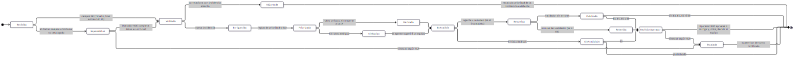
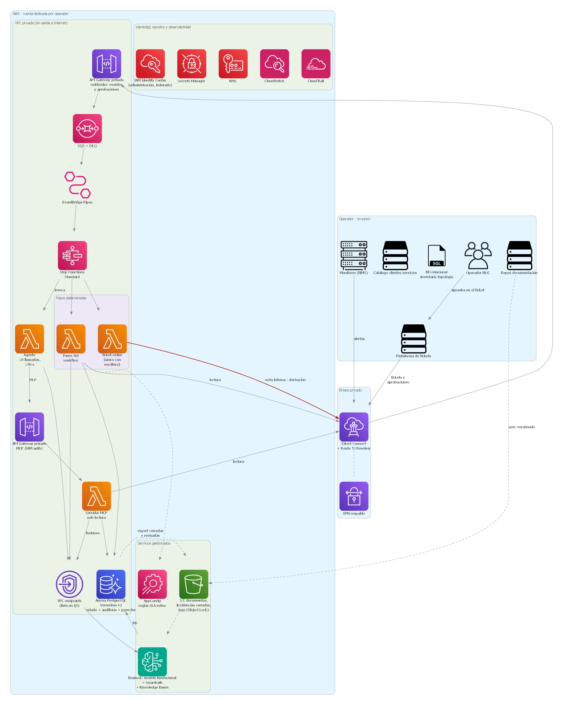

# 1. Resumen ejecutivo

La propuesta es un **workflow determinista** que orquesta las 8 actividades del proceso. Solo hay un **agente IA**, limitado a la investigación de causas probables, y dos **llamadas LLM puntuales** dentro del workflow: una para extraer campos de Tickets en texto libre y otra para redactar el resumen técnico. Todo lo que tiene reglas conocidas queda fuera del LLM: validación, correlación, urgencia, prioridad, SLA, ruteo, escritura en el ticket y escalamiento.

La garantía de que *la IA no ejecuta cambios sobre la red* no depende del prompt, sino de la infraestructura:

- El agente solo accede a tools de solo lectura, expuestas por un servidor MCP con un rol IAM de lectura.
- La única ruta de escritura (el Ticket maestro) pertenece al workflow, con un rol distinto.
- Toda salida generativa pasa una validación determinista (esquema, citas verificables y políticas) antes de llegar al Operador NOC.

Para no frenar la atención, **la derivación no espera ni a la IA ni a un humano**: se hace por regla en cuanto la Incidencia está priorizada (segundos), y el análisis IA se agrega después al Ticket maestro como nota interna. Solo espera al Operador NOC cuando falta información o el ruteo es ambiguo. Si el validador encuentra cualquier error en el análisis, el resumen se retiene hasta que el operador lo revise.

La solución corre en **AWS**, en topología híbrida: los sistemas del operador permanecen on-premise y se consultan por Direct Connect. Si la IA falla, la operación se degrada sin detenerse: los pasos deterministas siguen funcionando y la Incidencia se deriva por reglas, marcada "sin análisis IA".

**Qué está implementado y qué no.** Este documento es un diseño. El prototipo adjunto contiene los contratos de tools, el esquema de salida, las reglas deterministas y 18 casos de evaluación ejecutables. No se desplegó ningún servicio ni se invocó ningún modelo real.

## Términos

| Término | Significado |
|----|------------|
| **Alerta** | Evento automático del sistema de monitoreo. |
| **Ticket** | Registro en la plataforma de tickets, abierto por un usuario o por un sistema. |
| **Síntoma** | Manifestación descrita en un Ticket, normalizada a un catálogo cerrado (sin servicio, degradación, intermitencia, consulta). |
| **Incidencia** | Unidad de trabajo que se clasifica, investiga y deriva. Agrupa 1..N Alertas y Tickets correlacionados. |
| **Ticket maestro** | Ticket que actúa como registro oficial de la Incidencia. |
| **Operador NOC** | Persona de operaciones que revisa, aprueba y escala. |
| **Equipo resolutor** | Equipo técnico al que se deriva la Incidencia (Core IP, Transporte, Acceso FTTH, etc.). |

# 2. Supuestos

| # | Supuesto | Impacto si no se cumple |
|--|------------|----------|
| S1 | Los datos de incidencias pueden procesarse en un modelo fundacional gestionado (Bedrock), sin uso para entrenamiento y **con PII seudonimizada** antes de la invocación. La inferencia se hace **en la región de despliegue** (invocación on-demand en región) o, si el modelo elegido solo está disponible así, mediante un perfil de inferencia geográfico, que puede procesar la solicitud en otra región de la misma geografía. La opción se elige según el requisito de residencia del operador. | Si la residencia exige país y el modelo no está disponible en región, se usa un modelo open-weights on-prem. El resto del diseño no cambia: el LLM está detrás de la Converse API o de una interfaz equivalente. |
| S2 | Los sistemas on-prem exponen APIs o SQL de lectura, y la plataforma de tickets tiene una API REST (notas, asignación, estado) y webhooks de cambios. | Habría que construir conectores adicionales (por ejemplo, réplica de lectura o polling). |
| S3 | Volumen: unas 5.000 Alertas/día, que tras la correlación quedan en unas 300 Incidencias/día, con picos de 10× durante eventos masivos. | Se ajustan la concurrencia y el presupuesto. |
| S4 | Objetivo de latencia: p95 menor a 3 min desde la Alerta hasta el resumen en el Ticket maestro. | Se ajustan los límites del agente. |
| S5 | Existen Incidencias históricas cerradas con causa raíz y Equipo resolutor registrados (al menos unas 200 aprovechables para el golden set). | La evaluación offline empieza con un set más chico, ampliado con etiquetado en modo sombra. |
| S6 | Los procedimientos técnicos están en repositorios versionados (Git, SharePoint o Confluence) exportables a S3. | Se necesita un proceso de curación previo. |
| S7 | El operador tiene un IdP corporativo (SAML/OIDC) y un proceso de gestión de cambios independiente. | Las acciones sugeridas no tendrían un circuito de autorización al cual derivarse. |
| S8 | La empresa atiende a varios operadores: hay **un despliegue (cuenta AWS) por operador**, sin datos ni índices compartidos entre operadores. | Si se exigiera una plataforma compartida, el `tenant_id` sería un filtro obligatorio aplicado en el servidor MCP y en Aurora (no en el prompt), con casos de prueba de aislamiento. |

# 3. Matriz de decisiones de automatización

**Criterio de decisión.** Si una actividad tiene una regla conocida y verificable, se resuelve de forma determinista. Se usa IA generativa solo donde la entrada es lenguaje no estructurado o la ruta de razonamiento no es predecible. El **agente** se reserva para el único caso en que el *siguiente paso depende del resultado del anterior*, que es la investigación.

**Orden de ejecución.** La numeración sigue el enunciado, pero el workflow ejecuta 1 → 2 → 3 → 4 → **6** → 5 → 7 → 8: el ruteo por reglas y la derivación van antes de la investigación porque no dependen de la IA, y así la Incidencia llega al Equipo resolutor sin esperar el análisis.

| # | Actividad | Automatización elegida | Por qué | Alternativa descartada |
|-|----|-------|-------|------|
| 1 | Recibir Alertas y Tickets | **Integración determinista**: webhook → cola → inicio del workflow | Es transporte de datos; requiere durabilidad y reintentos, no razonamiento. | LLM para "leer" eventos: costo y latencia sin aportar nada. |
| 2 | Validar campos, deduplicar y correlacionar | **Workflow IA** solo para Tickets en texto libre: extrae equipo/servicio, ubicación y Síntoma con salida estructurada. Luego, **reglas**: campos obligatorios, Síntoma dentro del catálogo, correlación por equipo, ventana de tiempo y topología padre-hijo. | La extracción va primero porque la validación y el enriquecimiento necesitan esos campos. La deduplicación debe ser reproducible y auditable; la topología explica la mayor parte de la correlación (una caída upstream explica las Alertas downstream). | LLM para decidir si dos Alertas son "la misma": no determinista y difícil de auditar. Se pueden usar embeddings como señal secundaria en una fase 2, nunca como decisión. |
| 3 | Consultar cliente, servicio, ubicación, equipo y estado | **Consultas deterministas** (API/SQL) | Son lookups por clave; la respuesta correcta es única. | Que el agente lo consulte: lento, caro y no garantiza completitud. |
| 4 | Clasificar y priorizar, SLA | **Motor de reglas**: urgencia por severidad (Alertas) o por tabla Síntoma → urgencia (Tickets); matriz impacto × urgencia; tabla de SLA | El SLA es contractual y debe ser exacto y explicable. La IA solo nombra el Síntoma; la urgencia la fija la tabla, y un Síntoma fuera del catálogo genera E1. | LLM decide la prioridad o la urgencia: inaceptable para SLA y auditoría. |
| 5 | Investigar causas probables | **Agente IA** (loop acotado con RAG sobre procedimientos e histórico + tools de solo lectura) | La ruta de investigación depende de lo que se encuentra: si el equipo está bien se mira upstream, si hay un patrón histórico se busca su procedimiento. No es un flujo fijo. | Workflow IA de un solo paso (RAG fijo): no puede seguir pistas. Multi-agente: más costo y fallo sin más capacidad. |
| 6 | Identificar el equipo y derivar | **Tabla de ruteo** (tipo de equipo/dominio → Equipo resolutor), ejecutada justo después de priorizar; si es unívoca, se deriva de inmediato. Si es ambigua, se espera la sugerencia del agente y decide el Operador NOC. | El ruteo erróneo es el principal costo operativo (reasignaciones); la regla es explicable y no necesita esperar a la IA. | LLM decide el equipo: sin garantía. Se acepta solo como *sugerencia* con decisión humana. |
| 7 | Resumen técnico | **Workflow IA** (una llamada con salida estructurada: hechos, hipótesis, evidencias con cita, acciones sugeridas) | Redactar y sintetizar es la fortaleza del LLM, y la estructura permite validarlo de forma determinista. | Plantilla fija: no sintetiza la investigación. Agente: innecesario, no hay decisiones que tomar. |
| 8 | Actualizar el ticket y escalar | **Determinista** (escritura vía API por el workflow; reglas de escalamiento E1–E7) + **humano en el loop** | Escribir en sistemas del operador y decidir el escalamiento son acciones con impacto: deben ser predecibles. | Que el agente escriba directamente: viola el requisito de no actuar sin controles. |

**Resultado: 1 agente, 2 llamadas LLM puntuales y el resto determinista.**

## Señales de escalamiento al Operador NOC

Ninguna depende de una "confianza" autodeclarada por el LLM, porque no es una señal fiable. Todas son verificables, y solo E1 y E3 impiden derivar:

| Código | Condición | Efecto |
|--|----------|------|
| E1 | Faltan campos obligatorios tras la extracción, o el Síntoma no está en el catálogo | **Bloquea la derivación** hasta que el Operador NOC complete los datos. |
| E3 | Ruteo ambiguo o tipo de equipo sin regla | **Bloquea la derivación**: decide el Operador NOC. |
| E2 | Salida no verificable: fuera de esquema, cita inexistente o hipótesis sin evidencia | Ya derivada por regla; **el resumen se retiene** hasta que lo revise el operador. |
| E4 | Prioridad P1 | Ya derivada por regla; revisión humana del resumen **en paralelo**. |
| E5 | El agente agotó su presupuesto de pasos o tiempo | Revisión en paralelo; el resumen se marca "investigación incompleta". |
| E6 | Hay una acción sugerida que es un cambio | Revisión en paralelo; la acción se deriva a gestión de cambios y nunca se ejecuta. Si la acción no viene marcada como que requiere autorización, o es un cambio clasificado como diagnóstico, **el resumen se retiene**. |
| E7 | IA no disponible | Marca de degradación; no escala por sí sola. |

**Regla de publicación del resumen:** cualquier error del validador (E2 o E6 con error) retiene el resumen; solo un resumen sin errores se publica como nota interna.

# 4. Arquitectura conceptual / lógica

Código de colores: gris = determinista; violeta = IA generativa; verde = control de seguridad o validación; azul = datos; naranja = personas.

## 4.1 Componentes, datos y límites de acceso

| Componente | Función | Datos que recibe / entrega | Límite de acceso |
|---|---|---|---|
| Ingesta (cola + DLQ) | Desacoplar fuentes y asegurar entrega | Alertas y Tickets crudos | Solo escritura en la cola; los mensajes malformados van a la DLQ. |
| Workflow de Incidencia | Orquestar las 8 actividades, persistir estados, aplicar reglas, escalar | Estado de la Incidencia | Lee vía conectores; **único componente con escritura** al Ticket maestro (vía `ticket-writer`). |
| Conectores de lectura | Acceder a monitoreo, catálogo, BD relacional y plataforma de tickets | Datos operacionales | Cuentas de servicio **read-only** en origen. |
| Enmascarado PII + Guardrails | Seudonimizar clientes, contactos e IPs antes de cualquier llamada al modelo; filtrar entrada y salida | Texto → texto con tokens (`CLIENTE_3`) | El mapa de reidentificación vive en Aurora y nunca se envía al modelo. |
| LLM extracción (workflow IA) | Texto libre del Ticket → equipo/servicio, ubicación y Síntoma | JSON con esquema fijo | Sin tools. |
| Agente de investigación | Formular y contrastar hipótesis | Contexto de la Incidencia → hallazgos con `evidence_id` | Solo tools MCP de lectura; ≤8 llamadas, ≤90 s, presupuesto de tokens. |
| Servidor MCP | Exponer 6 tools con contrato (ver anexo) | Consultas → resultados con `evidence_id`, **seudonimizados antes de devolverse** | Rol IAM solo de lectura; sin tools de escritura. |
| LLM resumen (workflow IA) | Redactar el resumen técnico estructurado | Hechos y evidencias → JSON `ResumenTecnico` | Sin tools. |
| Validación determinista | Verificar esquema, que cada cita exista en la traza, hipótesis con evidencia y acciones de cambio marcadas | `ResumenTecnico` + traza → errores, códigos de escalamiento y si el resumen se publica o se retiene | No invoca el LLM. |
| Memoria de la Incidencia | Estado, hechos, decisiones y auditoría | Persistencia | El agente la *lee* (vía tool); solo el workflow escribe. |
| Índice vectorial (RAG) | Procedimientos versionados e Incidencias cerradas y revisadas | Fragmentos con documento y versión | Ingesta controlada; el agente no escribe. |

## 4.2 Memoria

| Tipo | Contenido | Ciclo de vida | Quién escribe |
|---|---|---|---|
| De trabajo | Mensajes y resultados de tools de una ejecución del agente | Se descarta al terminar; la traza queda en auditoría | Loop del agente |
| De la Incidencia | Hechos, hipótesis, decisiones, aprobaciones | Mientras dure la Incidencia y el período de retención | Solo el workflow, con salida validada |
| Institucional | Procedimientos e Incidencias cerradas, con causa raíz confirmada por humanos | Permanente y versionada | Proceso de ingesta, nunca el agente |

No hay memoria que el agente escriba libremente: eso sería un vector de envenenamiento persistente.

## 4.3 Estados, fallos y escalamiento del workflow

El diagrama de estados completo está en la página siguiente. Ante cada fallo, el workflow se comporta así:

| Fallo | Comportamiento |
|---|---|
| Conector on-prem caído | Reintento con backoff (3×). Si persiste, continúa con los datos disponibles, marca los "datos faltantes" en el resumen y genera E1 si el dato era obligatorio. |
| Bedrock con throttling o caído | Reintento con backoff. Si persiste, pasa a SinAnalisisIA (E7): derivación por reglas, o al Operador NOC si el ruteo es ambiguo. |
| Agente excede sus límites | Devuelve lo hallado marcado como incompleto (E5). |
| Salida inválida | 1 reintento del resumen con los errores del validador como feedback. Si vuelve a fallar, el resumen se retiene (E2 o E6). La Incidencia ya fue derivada por regla, así que el fallo no retrasa la atención. |
| Alertas simultáneas del mismo equipo | La correlación toma un bloqueo por equipo en Aurora (`pg_advisory_xact_lock`), así que dos ejecuciones concurrentes no crean Incidencias duplicadas. Al adjuntar, se recalcula la prioridad de la Incidencia existente. |
| Operador NOC no responde | Timeout ligado al SLA de la prioridad. Al vencer, escala al supervisor de turno. |
| Mensaje malformado | DLQ, más una alarma. |

## 4.4 El agente de investigación

- **Entrada**: la Incidencia enriquecida y seudonimizada (equipo, servicios, Alertas correlacionadas y prioridad).
- **Tools**: `get_device_status`, `get_topology_neighbors`, `get_service_context`, `get_incident_timeline`, `search_procedures` y `search_similar_incidents`. Todas son de lectura, devuelven un `evidence_id` y llegan seudonimizadas.
- **Salida**: hallazgos y una sugerencia de equipo, cada afirmación con su `evidence_id`. La sugerencia de equipo solo se usa si el ruteo por regla fue ambiguo (E3), y la decide el Operador NOC.
- **Límites**: máximo 8 tool calls, 90 s y un presupuesto de tokens. El contenido proveniente de Tickets y documentos va delimitado como *dato no confiable* en el prompt.
- **No puede**: escribir en ningún sistema, ejecutar comandos ni decidir la urgencia, la prioridad o el escalamiento.

# 5. Arquitectura física (AWS, híbrida)

| Necesidad | Servicio | Justificación | Alternativa descartada |
|---|---|---|---|
| Conectividad con el operador | **Direct Connect** + Site-to-Site VPN de respaldo; **Route 53 Resolver**: endpoint inbound para que on-prem resuelva los nombres privados de AWS, y endpoint outbound con reglas de reenvío para que los conectores y el MCP resuelvan los nombres de los sistemas on-prem | Latencia estable y tráfico privado hacia sistemas críticos. | Solo VPN: aceptable para un piloto, no para producción. |
| Ingesta | **API Gateway privado** → **SQS** (+DLQ) → **EventBridge Pipes** | Absorbe picos 10× (S3), con reintentos y DLQ, sin código de pegamento. | Kinesis: sobredimensionado para unas 5.000 Alertas/día. |
| Orquestación | **Step Functions Standard** | Estados explícitos, reintentos y catch por estado, `waitForTaskToken` para HITL (ADR 0001). El historial de ejecución se conserva 90 días; la auditoría permanente se escribe en Aurora y S3. | Temporal o LangGraph: un servicio más que operar. |
| Pasos deterministas | **Lambda** en VPC | Tareas cortas y sin estado; escalan a cero. | Contenedores: innecesario para pasos de segundos. |
| Reglas de SLA, urgencia y ruteo | **AppConfig** | Las reglas cambian por negocio: despliegue validado, versionado y con rollback sin redeploy. | Reglas hardcodeadas: cada cambio requiere un release. |
| Agente | **Lambda** + Bedrock Converse API (loop propio) | Una invocación por Incidencia, de hasta ~90 s, con límites explícitos y trazables, en la misma plataforma que el resto de los pasos (ADR 0002). | ECS Fargate: 30–60 s de arranque por tarea sin beneficio. Bedrock Agents: loop opaco. |
| Tools (MCP) | **Lambda** detrás de un **API Gateway privado con autenticación IAM** | Frontera de seguridad separada con un rol de solo lectura; seudonimiza las respuestas (ADR 0003). | Tools dentro del agente: el agente tendría las credenciales. |
| Aprobación humana (HITL) | El Operador NOC aprueba o corrige **en la plataforma de tickets**. Su webhook entra por el API Gateway privado y una Lambda verifica, contra la API de tickets, que quien aprobó pertenece al grupo NOC; luego busca el task token en Aurora y reanuda el workflow. | Sin interfaz nueva: el operador trabaja donde ya trabaja, con su identidad corporativa. El task token nunca sale de AWS. | Consola propia con login: otra aplicación que construir y asegurar. |
| Modelos | **Amazon Bedrock**: un modelo fundacional de nivel pequeño (extracción) y uno de nivel medio (agente y resumen), con versión fijada. Opciones en Bedrock: Anthropic Claude, Amazon Nova, Meta Llama o Mistral; la elección final se hace con el golden set de §7 (calidad en español, tool use, costo y latencia). | Modelos gestionados, sin uso de datos para entrenamiento, sin GPU que operar. Dos niveles para optimizar costo. La Converse API es común a todos los modelos, así que cambiar de modelo no cambia el código. | Self-hosting en GPU: mayor costo y operación; queda como plan B ante S1. |
| Guardrails | **Bedrock Guardrails** | Detección de PII, temas denegados y prompt attacks como segunda capa tras el enmascarado propio. | Solo enmascarado propio: sin defensa en profundidad. |
| RAG | **Bedrock Knowledge Bases** sobre **Aurora PostgreSQL + pgvector**, con embeddings multilingües. Fuentes en S3: procedimientos sincronizados desde los repos e Incidencias cerradas y revisadas, exportadas desde Aurora. El MCP consulta la KB con `Retrieve`. | Ingesta y chunking gestionados; pgvector reutiliza el mismo Aurora. Embeddings multilingües porque la documentación está en español. | OpenSearch Serverless: costo mínimo alto para este volumen. |
| Estado y auditoría | **Aurora PostgreSQL Serverless v2** | Memoria de la Incidencia, auditoría, task tokens y vectores en un solo motor relacional. | DynamoDB: consultas de auditoría y joins más difíciles. |
| Documentos y logs | **S3** con SSE-KMS; logs de invocación del modelo y auditoría con **Object Lock** | Fuentes del RAG y auditoría inmutable de prompts y respuestas. | — |
| Identidad | Humanos: aprueban con su identidad en la plataforma de tickets (federada al IdP del operador). **IAM Identity Center** federado al IdP solo para administración de AWS. Servicios: un rol IAM por componente. | SSO corporativo; mínimo privilegio por servicio. | Usuarios IAM locales. |
| Secretos y cifrado | **Secrets Manager** (rotación) + **KMS** (claves propias) | Credenciales de conectores fuera del código; cifrado en reposo. | — |
| Red | VPC privada sin salida a Internet. **VPC endpoints**: `bedrock-runtime`, `bedrock-agent-runtime` (Retrieve), `execute-api`, `states`, `sqs`, `secretsmanager`, `kms`, `logs`, `monitoring`, `sts`, `appconfigdata` y S3 (gateway). Security groups: el agente solo puede salir hacia el endpoint del MCP y el de Bedrock. | Ningún tráfico sale a Internet; el agente no tiene otra ruta de red. | NAT Gateway: abre una ruta de exfiltración. |
| Observabilidad | **CloudWatch** (métricas, logs, alarmas), **CloudTrail** (API), Bedrock invocation logging, historial de Step Functions | Nativos y suficientes. | X-Ray, Langfuse o similar: mejora futura si hace falta análisis de trazas o de calidad de prompts. |

**Región.** La región de referencia es us-east-1, por disponibilidad de modelos en Bedrock. Si el operador exige residencia en Latinoamérica, hay que validar antes de producción la disponibilidad de los modelos y de Knowledge Bases en sa-east-1 o mx-central-1, y si requieren perfil de inferencia geográfico (ver S1 y §8.6).

# 6. Seguridad: matriz de riesgos y controles

Marco: **OWASP Top 10 for LLM Applications (2025)** más riesgos clásicos de plataforma. Cada control indica **cómo se verifica**.

| Riesgo | Escenario | Controles | Verificación |
|----|-----|--------|-------|
| **LLM01 Prompt injection** (indirecta) | El texto de un Ticket o de un documento instruye "reinicia el router", o intenta sesgar el resumen o el ruteo. | El agente no tiene tools de escritura (ADR 0003); el contenido externo va delimitado como dato no confiable; Guardrails contra prompt attacks; el ruteo y la prioridad son por reglas; los hechos exigen evidencia de tools, no del texto del Ticket. | Red-team periódico con el modelo real (tasa de bloqueo en la capa 2 de §7). El caso C07 del prototipo verifica solo la última barrera: que el validador detecte una acción de cambio inducida y retenga el resumen para que no se publique (la salida del modelo es simulada). |
| **LLM06 Agencia excesiva** | El agente ejecuta acciones sobre la red o el ticket. | Rol del agente: solo `execute-api` sobre el MCP y `bedrock:InvokeModel`. La escritura está aislada en `ticket-writer`. Cuentas on-prem del MCP de solo lectura. Security groups que limitan la salida del agente. | Policy-as-code en CI (cfn-guard o Checkov): el build falla si el rol del agente tiene `Put*`, `Update*` o `Delete*`. **Test negativo**: un intento de escritura con las credenciales del MCP contra cada sistema on-prem debe fallar. |
| **LLM02 Fuga de información sensible** | Datos de clientes en prompts, respuestas de tools, logs o respuestas del modelo. | Seudonimización previa, también en las respuestas del MCP; Guardrails PII; inferencia en región (S1); VPC endpoints; logs cifrados con KMS; un despliegue por operador (S8). | Escaneo periódico con Macie del bucket de logs de invocación: cero hallazgos de PII. |
| **LLM09 Desinformación / alucinación** | Una hipótesis inventada se presenta como hecho. | Esquema que separa hechos de hipótesis; cada afirmación lleva un `evidence_id` verificado contra la traza; si falla, E2 y el resumen se retiene. | Casos C05, C06 y C13; métrica de groundedness en la evaluación offline. |
| **LLM05 Manejo inseguro de la salida** | La salida del LLM se usa sin validar (ruteo, campos, HTML en el ticket). | Validación Pydantic; la salida nunca decide urgencia, prioridad ni SLA; escape de contenido al escribir en el ticket. | Tests deterministas en CI. |
| **LLM04 / LLM08 Envenenamiento de datos o embeddings** | Un documento o Incidencia histórica manipulada sesga al agente. | Solo se ingestan Incidencias cerradas *y revisadas por humanos*; fuentes con control de versiones y aprobación; metadato de versión en cada fragmento; índices separados por operador (S8). | Auditoría de la ingesta (quién y qué versión); la evaluación de recuperación detecta derivas. |
| **LLM10 Consumo desmedido** | Loop del agente, picos o abuso que disparan el costo. | Límites de pasos, tiempo y tokens; concurrencia máxima por cola; cuotas de Bedrock. | Alarmas de CloudWatch de costo por Incidencia y tokens por hora; AWS Budgets. |
| **LLM03 Cadena de suministro / cambio de modelo** | Un cambio de versión del modelo degrada la calidad sin aviso. | Versión de modelo fijada; un cambio de modelo o prompt pasa por el gate de evaluación. | Pipeline: no se despliega si la regresión baja de los umbrales de §7. |
| **LLM07 Fuga del system prompt** | Exposición de la lógica interna. | El prompt no contiene secretos ni reglas sensibles; las reglas viven en AppConfig. | Revisión de prompts en code review. |
| Aprobación no autorizada | Alguien fuera del NOC aprueba o desbloquea una Incidencia. | La Lambda de aprobación verifica el grupo del aprobador contra la plataforma de tickets; el task token nunca sale de AWS; la aprobación queda registrada con la identidad. | Test: un webhook con un aprobador fuera del grupo NOC no reanuda el workflow; registro en Aurora y CloudTrail. |
| Credenciales expuestas | Las credenciales on-prem se filtran. | Secrets Manager con rotación; cuentas read-only en origen. | Rotación automática verificada; escaneo de secretos en el repo. |
| Disponibilidad | Caída del LLM o de un conector. | Degradación (E7); DLQ; Direct Connect + VPN. | Pruebas de caos: simular el corte de Bedrock y verificar la derivación por reglas (caso C12). |

# 7. Estrategia de evaluación de la IA generativa

## 7.1 Qué se evalúa

| Componente | Qué se mide |
|---|---|
| Extracción (paso 2) | Exactitud por campo frente a etiquetas humanas, incluido el Síntoma. |
| Correlación (paso 2, determinista pero crítica) | Si agrupa bien las Alertas y Tickets de una misma Incidencia. |
| Recuperación RAG | Si trae el procedimiento y la Incidencia similar correctos. |
| Agente (paso 5) | Si llega a la causa raíz correcta, con qué eficiencia y respetando los límites. |
| Resumen (paso 7) | Fidelidad a la evidencia, completitud y utilidad para el Operador NOC. |
| Sistema completo | Tiempo hasta triage, calidad del ruteo y costo. |

## 7.2 Tres capas

**Capa 1: determinista** (en CI, en cada cambio de prompt, modelo, reglas o código).

- Validez de esquema, existencia de citas en la traza, hipótesis con evidencia y acciones de cambio marcadas.
- Reglas de urgencia, prioridad, SLA, ruteo, escalamiento y derivación con casos tabulados.
- Casos adversariales sobre salidas simuladas: acción de cambio inducida, cita alucinada, acción disfrazada, campos faltantes e IA caída.
- **Implementado en el prototipo**: 18 casos, todos pasan (`eval_deterministic.py`). Las salidas del modelo en esos casos son fijas: el prototipo verifica el *validador y las reglas*, no la calidad ni la robustez de un modelo real.

**Capa 2: offline probabilística** (golden set de unas 200 Incidencias históricas anonimizadas más casos sintéticos).

**Etiquetado.** Ingenieros NOC senior etiquetan cada caso con la causa raíz (de una taxonomía controlada de causas), el Equipo resolutor, la agrupación correcta de Alertas y los documentos relevantes. Un 20% se etiqueta dos veces para medir la concordancia entre etiquetadores.

| Métrica | Componente | Método | Umbral inicial propuesto |
|---|---|---|---|
| Exactitud por campo | Extracción | Comparación exacta con la etiqueta | ≥ 95% |
| Precisión / recall por pares | Correlación | Pares de eventos agrupados frente a la agrupación etiquetada | ≥ 0,90 / ≥ 0,85 |
| Recall@3 / MRR | Recuperación | Documento o Incidencia relevante en el top 3 | Recall@3 ≥ 0,85 |
| Causa raíz top-1 / top-3 | Agente | Comparación con la causa de la taxonomía (LLM-as-judge + revisión humana en muestra) | top-3 ≥ 0,70 |
| Pasos promedio y % de E5 | Agente | Traza | E5 < 10% |
| Groundedness / fidelidad | Resumen | LLM-as-judge con rúbrica, **calibrado contra etiquetas humanas** (concordancia κ ≥ 0,7 antes de confiar en él) | ≥ 0,90 |
| Calibración de `probabilidad` | Resumen | Tasa de acierto de las hipótesis por nivel (alta/media/baja) | Monótona; si no, se elimina el campo |
| Accuracy de ruteo | Ruteo + sugerencia IA | Comparación con el Equipo resolutor final | ≥ 0,90 |
| Tasa de bloqueo de inyección | Seguridad (red-team con el modelo real) | Casos adversariales | 100% sin efectos sobre ruteo, prioridad o acciones |

Cada evaluación se corre varias veces (n ≥ 3) para estimar la varianza. Con 200 casos, un umbral de 0,70 tiene un intervalo de confianza del 95% de unos ±6 puntos: el set detecta regresiones grandes, no diferencias finas. Por eso las variantes se comparan con pruebas pareadas sobre los mismos casos, y el set crece con el etiquetado continuo del modo sombra.

**Capa 3: online** (en producción).

| Métrica | Señal |
|---|---|
| **Tiempo hasta triage** (objetivo del reto) | Desde la Alerta hasta la derivación, comparado con la línea base actual. |
| Tasa de aceptación del resumen | Aprobaciones sin edición del Operador NOC. |
| Distancia de edición del resumen | Cuánto corrige el operador. |
| Tasa de reasignación | Derivaciones erróneas. |
| Tasa de escalamiento por código (E1–E7) | Detecta derivas: por ejemplo, un aumento de E2 indica que el modelo cita peor. |
| Costo y latencia por Incidencia | p50/p95 y USD por Incidencia. |

Las correcciones del Operador NOC alimentan el golden set (con revisión), lo que cierra el ciclo de mejora.

## 7.3 Despliegue gradual

1. **Sombra** (4–6 semanas): la IA genera el análisis pero no se publica. El Operador NOC trabaja como hoy y se comparan resultados. Pasa a la fase 2 si se cumplen los umbrales de la capa 2 sobre datos reales.
2. **Asistido**: el resumen se publica como nota interna; la derivación automática ocurre solo con ruteo unívoco; el resto requiere decisión humana.
3. **Nunca autónomo** para acciones sobre la red: siempre pasan por la gestión de cambios del operador.

# 8. Operación y limitaciones

## 8.1 Latencia y costo (estimación)

| Paso | Latencia estimada | Tokens estimados por Incidencia |
|---|---|---|
| Pasos deterministas (1–4, 6, 8) | < 5 s | — |
| Extracción (modelo pequeño, solo Tickets) | 1–2 s | ~1,5k entrada / 0,3k salida |
| **Hasta la derivación** (ruteo unívoco) | **< 10 s** | |
| Agente (modelo medio, ≤8 tools) | 30–90 s | ~30k entrada / 2k salida (acumulado) |
| Resumen (modelo medio) | 5–10 s | ~8k entrada / 1k salida |
| **Hasta el resumen en el ticket** | **~1–2 min (p95 < 3 min)** | |

Con precios de lista de referencia de USD 3 / 15 por millón de tokens (entrada/salida) para el modelo medio y USD 1 / 5 para el pequeño, el costo de LLM ronda **USD 0,15 por Incidencia**, unos **USD 45/día** a 300 Incidencias/día. *Los precios dependen del modelo elegido y deben verificarse contra la lista vigente de Bedrock.* Prompt caching sobre el system prompt y los contratos de tools lo reduciría. El costo de infraestructura (Aurora Serverless, Lambda, Direct Connect, Guardrails, embeddings) es aparte y está dominado por Direct Connect.

## 8.2 Observabilidad

- **Por Incidencia**: historial de Step Functions (90 días) + tabla de auditoría permanente (quién, qué, con qué evidencia, versión de prompt y modelo).
- **Por invocación LLM**: Bedrock invocation logging (S3 con Object Lock) + métricas de tokens y latencia.
- **Alarmas**: DLQ no vacía, tasa E7 > 0, costo por hora, p95 > 3 min, aumento de E2.

## 8.3 Resiliencia

La IA es un acelerador, no una dependencia crítica: con Bedrock caído la operación continúa por reglas (E7). La ingesta es durable (SQS + DLQ) y Step Functions reintenta por estado. El enlace con el operador es redundante (Direct Connect + VPN).

## 8.4 Supervisión humana

- El Operador NOC decide en E1 y E3 (bloquean la derivación) y revisa en paralelo E2, E4, E5 y E6. Todo resumen con errores del validador queda retenido hasta su revisión.
- Toda sugerencia de ruteo hecha por IA requiere decisión humana.
- Las acciones de cambio nunca se ejecutan: se derivan a la gestión de cambios.
- Las correcciones del operador quedan registradas y alimentan la evaluación.

## 8.5 Riesgos residuales

- **Correlación imperfecta**: Incidencias sin relación topológica conocida pueden quedar separadas. Se mide con precisión/recall por pares y se mitiga con revisión del operador.
- **El validador de citas comprueba que la evidencia existe, no que la respalde.** Una cita real puede usarse para sostener una conclusión incorrecta. Se mitiga con groundedness en la evaluación y con revisión humana.
- **Detección de acciones de cambio por lista de verbos** (respaldo del validador): puede tener falsos negativos con redacciones atípicas y falsos positivos con verbos ambiguos. Debe evaluarse en el golden set.
- **Prompt injection que sesga el texto del resumen**: sin tools de escritura no puede actuar, pero puede inducir una hipótesis errónea. Se mitiga con evidencia obligatoria, ruteo por reglas y revisión humana.
- **Calidad del histórico**: si las causas raíz registradas son pobres, el RAG de Incidencias similares aporta poco.
- **Dependencia del enmascarado**: un identificador no reconocido podría llegar al modelo. Guardrails es la segunda capa, no una garantía.

## 8.6 Pendientes antes de producción

1. Confirmar S1 con el área legal y de cumplimiento del operador: residencia de datos, uso de un modelo gestionado y si se acepta un perfil de inferencia geográfico.
2. Validar la disponibilidad de los modelos candidatos y de Knowledge Bases en la región exigida, y elegir el modelo con el golden set.
3. Inventariar las APIs y webhooks reales de los sistemas on-prem y la plataforma de tickets (S2).
4. Construir y etiquetar el golden set con el equipo NOC; acordar la taxonomía de causas y los umbrales.
5. Definir con negocio la matriz de prioridad, la tabla Síntoma → urgencia, el SLA y la tabla de ruteo reales (las del prototipo son supuestos).
6. Prueba de carga con picos 10× y prueba de caos de Bedrock y de los conectores.
7. Pentest y red-team de prompt injection antes de la fase asistida.

# 9. Decisiones técnicas principales

| ADR | Decisión |
|-|---------|
| 0001 | Workflow determinista con un único agente de investigación (no un agente orquestador ni multi-agente). |
| 0002 | Loop de agente propio sobre la Bedrock Converse API, en Lambda y con límites duros (no Bedrock Agents ni Fargate). |
| 0003 | Servidor MCP de solo lectura como frontera de seguridad; la escritura solo la hace el workflow. |

Otras decisiones: reglas fuera del LLM (urgencia, prioridad, SLA, ruteo y escalamiento); extracción antes de la validación; escalamiento por señales verificables en lugar de "confianza" del modelo; ruteo y derivación antes de la investigación, sin esperar a la IA ni al humano salvo E1/E3; retención del resumen ante cualquier error del validador; aprobación en la plataforma de tickets; degradación sin IA; despliegue sombra → asistido.

# 10. Preguntas anticipadas

**¿Por qué no derivar sin esperar al humano, incluso en P1?** Así está diseñado: en cualquier prioridad, incluida P1, se deriva por regla apenas se prioriza (en segundos), sin esperar al humano ni al análisis IA. La revisión humana del análisis corre en paralelo. Solo se espera al Operador NOC cuando no hay datos para derivar (E1) o no se sabe a quién (E3).

**¿Por qué MCP si el loop del agente es propio?** Una Lambda de tools con su propio rol daría la misma frontera IAM. MCP aporta un contrato estándar (descubrimiento y esquemas) que permite reutilizar las tools desde otros clientes, como un asistente para el NOC. Sin ese segundo consumidor, la Lambda simple sería igual de válida (ADR 0003).

**¿Qué puede hacer un prompt injection si no hay tools de escritura?** No puede actuar sobre la red ni sobre el ticket, pero puede intentar sesgar el resumen o sugerir otro equipo. El ruteo y la prioridad son por reglas, los hechos exigen evidencia devuelta por las tools (no texto del Ticket) y el operador revisa. La robustez del modelo se mide con red-team, no con el prototipo.

**¿Bastan 200 casos?** Sirven para detectar regresiones grandes (IC95% de unos ±6 puntos a 0,70), no para distinguir variantes parecidas. Se complementan con pruebas pareadas y con el crecimiento del set en modo sombra.

**¿Quién decide qué es la causa "correcta" o un documento "relevante"?** Ingenieros NOC senior, sobre una taxonomía controlada de causas, con doble etiquetado en el 20% de los casos para medir concordancia.

**¿Cómo se usa la `probabilidad` alta/media/baja de las hipótesis?** Solo para ordenarlas en el resumen; no dispara ninguna decisión. Se mide su calibración en el golden set y, si no es monótona, se elimina.

**¿Cómo se evalúa la correlación si es determinista?** Con precisión y recall por pares contra agrupaciones etiquetadas del histórico. Es crítica porque un error ahí duplica o mezcla Incidencias antes de que intervenga la IA.

# Anexo A. Prototipo

En la carpeta `prototipo/`:

| Archivo | Contenido |
|---|---|
| `tools.json` | Contratos (JSON Schema) de las 6 tools MCP, todas de solo lectura y con `evidence_id` en la salida. |
| `resumen.py` | Esquema Pydantic `ResumenTecnico` y el validador determinista (citas, hipótesis, acciones de cambio). |
| `reglas.py` | Campos obligatorios, urgencia (severidad y Síntoma), prioridad/SLA, ruteo, códigos de escalamiento, derivación y publicación del resumen (valores supuestos). |
| `casos.json` | 18 casos: normales, Tickets en texto libre, escalamiento, adversariales sobre salidas simuladas (acción inducida, cita alucinada, acción disfrazada, falso positivo) y degradación. |
| `eval_deterministic.py` | Corre los casos; sale con código 1 si alguno falla (gate de CI). |
| `resultado-evaluacion.txt` | Salida de la última ejecución, para consultarla sin ejecutar nada. |

Ejecución: `uv run --python 3.13 --with pydantic python eval_deterministic.py` → `18/18 casos OK`.

**No implementado**: el loop del agente, el servidor MCP, el enmascarado, la definición ASL de Step Functions, la infraestructura y cualquier llamada a un modelo real.
